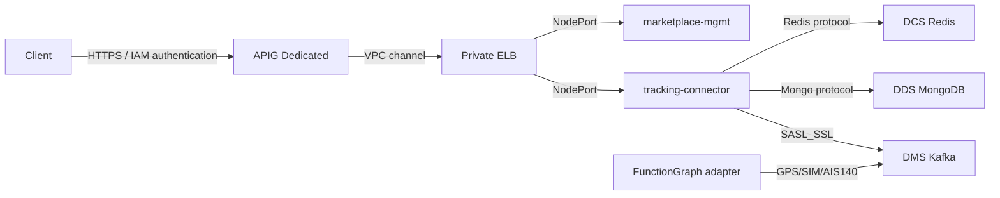

# automotive-vehicle-tracking-platform

[](LICENSE)


A **multi-vendor vehicle tracking reference platform** built on Huawei Cloud services: it standardizes fragmented vehicle location data sources (GPS / SIM / AIS140 and other vendor protocols) into a unified event stream, provides a consistent tracking API externally, and includes session caching, rule storage, and subscription management.

## 1. Overview

### Introduction

- Serverless functions (FunctionGraph) handle vendor protocol adaptation and write normalized data to the event bus;
- Container workloads (CCE) host tracking orchestration and subscription management, distributed via a private ELB;
- APIG provides a unified HTTPS entry point (IAM authentication), with a VPC channel connecting directly to the private ELB;
- All data resides in private subnets, with encryption in transit and at rest enabled for messages / cache / database.

This platform is suitable for scenarios that need to aggregate location data from multiple sources, such as fleet management, insurance technology, and logistics tracking.

For architecture details, see [docs/architecture.md](docs/architecture.md).

---

## 2. Table of Contents

- [1. Overview](#1-overview)
- [2. Table of Contents](#2-table-of-contents)
- [3. Architecture Diagram](#3-architecture-diagram)
- [4. Highlights](#4-highlights)
- [5. Cloud Services Used](#5-cloud-services-used)
- [6. Prerequisites](#6-prerequisites)
- [7. Quick Start](#7-quick-start)
- [8. Step-by-Step Deployment](#8-step-by-step-deployment)
- [9. Usage / Verification](#9-usage--verification)
- [10. Cleanup](#10-cleanup)
- [11. Detailed Explanation](#11-detailed-explanation)
- [12. Dependencies](#12-dependencies)
- [13. FAQ / Troubleshooting](#13-faq--troubleshooting)
- [14. Contributing](#14-contributing)
- [15. License](#15-license)
- [16. Contact / Maintainers](#16-contact--maintainers)

---

## 3. Architecture Diagram



For details on each layer and the network topology, see [docs/architecture.md](docs/architecture.md).

---

## 4. Highlights

- **Multi-vendor protocol standardization**: heterogeneous GPS / SIM / AIS140 protocols are unified by FunctionGraph into a `LOCATION_UPDATE` event stream;
- **Fully internal data plane**: containers / messaging / cache / database all reside in private subnets, with no public ports exposed;
- **Unified API entry point**: APIG provides HTTPS + IAM authentication, with a VPC channel connecting directly to the private ELB;
- **Event-driven + traceable sessions**: Kafka carries the event stream, DDS persists session state;
- **One-click IaC delivery**: Terraform manages all infrastructure, reproducible together with build/deploy scripts.

---

## 5. Cloud Services Used

This practice uses the following Huawei Cloud services:

| Service | Purpose |
|-|-|
| CCE cluster + nodes | Container orchestration and tracking service runtime |
| ELB (dedicated) | Private load balancing, distributing requests to containers |
| APIG (dedicated edition) | Unified HTTPS API entry point (IAM authentication) |
| DMS Kafka | Vehicle location event stream |
| DCS Redis | Session cache |
| DDS replica set | Session state persistence (MongoDB protocol) |
| FunctionGraph | Vendor protocol adaptation |
| OBS / SWR / KMS / LTS | Object storage / image repository / key management / logging |

---

## 6. Prerequisites

- A Huawei Cloud account with the corresponding service permissions (VPC / CCE / ELB / APIG / DMS / DCS / DDS / FunctionGraph / SWR / KMS);
- Local tools: Terraform ≥ 1.9, kubectl, docker, bash;
- Key pair (CCE nodes), service passwords, target region, and availability zones.

---

## 7. Quick Start

```bash
# 1. Configure credentials (only written to deployment scripts, do not commit to the repository)
export HW_ACCESS_KEY="<AK>" HW_SECRET_KEY="<SK>"
export TF_VAR_kafka_password="<...>" TF_VAR_redis_auth_token="<...>" TF_VAR_mongo_password="<...>"

# 2. Deploy the infrastructure (see the deployment guide)
cd infra && terraform init && terraform plan && terraform apply

# 3. Build images and deploy containers (see src/containers)
cd ../src/containers && SWR_ADDR=... SWR_ORG=vehicle-tracking ./build-push.sh
kubectl apply -f tracking-connector/k8s.yaml -f marketplace-mgmt/k8s.yaml

# 4. Package and deploy the vendor adapter function (see src/functions/tracking-adapter/README.md)
cd ../functions/tracking-adapter && ./build.sh
```

---

## 8. Step-by-Step Deployment

### Step 1: Infrastructure

```bash
cd infra
terraform init            # initialize the provider
terraform plan            # preview resources (approximately 49)
terraform apply           # create resources (CCE cluster creation takes about 5-10 minutes)
```

Expected output: `Apply complete! Resources: 49 added`.

### Step 2: Container images and deployment

```bash
cd ../src/containers
docker login swr.cn-north-4.myhuaweicloud.com   # use the SWR temporary login command
./build-push.sh                                 # build and push two images
kubectl apply -f tracking-connector/k8s.yaml -f marketplace-mgmt/k8s.yaml
kubectl get pods                                # wait until all are Running
```

Expected output: `deployment.apps/tracking-connector created` etc., finally `1/1 Running`.

### Step 3: Vendor adapter function

```bash
cd ../functions/tracking-adapter
./build.sh                                     # package the zip and upload it to OBS
```

After upload, create the function in the FunctionGraph console and bind an OBS trigger / VPC.

For complete reproducible steps, dependency order, and troubleshooting, see [docs/deployment-guide.md](docs/deployment-guide.md).

---

## 9. Usage / Verification

### Usage and verification

1. `curl -k https://<APIG-域名>/tracking` → 401 (IAM authentication takes effect);
2. `POST /tracking {"vehicleId":"MH01AB1234"}` → returns `trackingId`;
3. The Kafka consumer can see `LOCATION_UPDATE` events;
4. The corresponding session record appears in the DDS `session_state` collection.

> This project has completed the above 4 verifications in a real Huawei Cloud environment (including Kafka event publishing and DDS write/read-back). All the above verifications were completed in a real Huawei Cloud environment, and the resources and results can be reproduced following the steps in this section.

For quality gates and residual risks, see [docs/response-constraints.md](docs/response-constraints.md).

After deployment, follow these steps to verify that the business functionality works before considering the delivery complete.

---

## 10. Cleanup

```bash
# 1. Delete container workloads
kubectl delete -f src/containers/tracking-connector/k8s.yaml
kubectl delete -f src/containers/marketplace-mgmt/k8s.yaml

# 2. Destroy all cloud resources
cd infra && terraform destroy
```

> ⚠️ `terraform destroy` deletes all associated resources; it is recommended to clean up immediately after verification.
> If deleting an ELB listener reports a conflict, delete the backend server group first and then the listener, following the dependency order.

---

## 11. Detailed Explanation

### Architecture and workflow

1. The client calls `POST /tracking` via APIG (HTTPS + IAM authentication);
2. APIG forwards the request to the private ELB via a VPC channel, and the ELB distributes it to tracking-connector on CCE;
3. tracking-connector generates a `trackingId`, publishes a `LOCATION_UPDATE` event to DMS Kafka, and records the session in DDS `session_state`;
4. The FunctionGraph adapter receives raw location data from each vendor, normalizes it, and writes it to the same Kafka event stream;
5. marketplace-mgmt provides subscription management and vendor registration APIs.

### API interfaces

| Method | Path | Description |
|-|-|-|
| POST | `/tracking` | Start tracking, returns `trackingId` |
| POST | `/discovery` | Query available vendors |
| DELETE | `/tracking/{id}` | Terminate a tracking session |
| GET | `/tracking/{id}/location` | Query the latest location |
| POST | `/marketplace/subscribe` | Subscribe to a vendor |

### Configuration items

| Environment variable | Description |
|-|-|
| `KAFKA_BOOTSTRAP_SERVERS_SSL` | DMS Kafka SASL_SSL address (`:9093`) |
| `KAFKA_TOPIC` | Event topic (default `vehicle-tracking-events`) |
| `MONGO_CONNECTION` | DDS MongoDB connection string |
| `CACHE_ENDPOINT` | DCS Redis domain name |

### Directory structure

```
├── docs/                            # practice documents
│   ├── architecture.md              # architecture description
│   ├── deployment-guide.md          # deployment guide
│   └── response-constraints.md      # quality gates and self-check
├── infra/                           # Terraform + huaweicloud (validate passed)
├── src/
│   ├── functions/tracking-adapter/  # FunctionGraph adapter (GPS/SIM/AIS140)
│   └── containers/                  # CCE deployment manifests + SWR push scripts
└── LICENSE                          # MIT-0
```

---

## 12. Dependencies

- Infrastructure: Terraform ≥ 1.9 + [huaweicloud provider](https://registry.terraform.io/providers/huaweicloud/huaweicloud)
- Containers: Python 3.12 (kafka-python / pymongo), CCE / SWR

---

## 13. FAQ / Troubleshooting

### FAQ

**Q: Containers are always Pending?**
A: CCE node resources are insufficient (this sample uses 2vCPU/4GB nodes ×2); reduce the replica count or resource requests.

**Q: Image pull reports 401?**
A: Pulling a private SWR repository on a node requires an imagePullSecret; create and configure `swr-cred` first.

**Q: Cannot connect to Kafka?**
A: DMS Kafka uses SASL_SSL (port 9093). Confirm the security group allows 9092-9094, and the client is configured to waive certificate verification.

**Q: APIG access returns 404?**
A: Confirm the API has been published to the RELEASE environment, and the VPC channel backend path matches the actual service path.

---

## 14. Contributing

Issues and Pull Requests are welcome. Please ensure:

- Run `terraform validate` after modifying Terraform and make sure it passes;
- Update the corresponding documentation when adding/modifying code;
- Follow the terms of [LICENSE](LICENSE).

---

## 15. License

This repository is licensed under [MIT-0 (MIT No Attribution)](https://opensource.org/license/mit-0), with the full [LICENSE](LICENSE) text included.

---

## 16. Contact / Maintainers
| Item | Content |
|---|---|
| **Creator** | [dgc-git](https://github.com/dgc-git) |
| **Maintainer** | [dgc-git](https://github.com/dgc-git) |
| **Contact** | GitHub Issues / PR (see [Section 14](#14-contributing)) |
