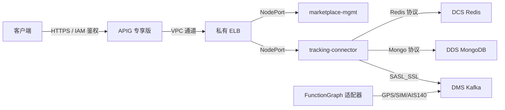

# automotive-vehicle-tracking-platform · 车辆追踪平台（华为云最佳实践）

[](LICENSE)


基于华为云服务构建的**多供应商车辆追踪参考平台**：把碎片化的车辆定位数据源
（GPS / SIM / AIS140 等供应商协议）标准化为统一事件流，对外提供一致的追踪 API，
并配套会话缓存、规则存储与订阅管理。

## 1. 简介 / Overview

### 简介


- 无服务器函数（FunctionGraph）负责供应商协议适配，标准化后写入事件总线；
- 容器工作负载（CCE）承载追踪编排与订阅管理，经私有 ELB 分发；
- APIG 提供统一 HTTPS 入口（IAM 鉴权），VPC 通道直连私有 ELB；
- 全链路数据位于私有子网，消息 / 缓存 / 数据库均启用传输与静态加密。

本平台适用于车队管理、保险科技、物流追踪等需要聚合多来源定位数据的场景。

架构详情见 [docs/architecture.md](docs/architecture.md)。

---

## 2. 目录

- [1. 简介 / Overview](#1-简介--overview)
- [2. 目录](#2-目录)
- [3. 架构图](#3-架构图)
- [4. 方案亮点](#4-方案亮点)
- [5. 涉及云服务](#5-涉及云服务)
- [6. 前置条件](#6-前置条件)
- [7. 快速开始](#7-快速开始)
- [8. 分步部署](#8-分步部署)
- [9. 使用方法 / 验证](#9-使用方法--验证)
- [10. 清理资源](#10-清理资源)
- [11. 详细说明](#11-详细说明)
- [12. 依赖](#12-依赖)
- [13. FAQ / 故障排除](#13-faq--故障排除)
- [14. 贡献指南](#14-贡献指南)
- [15. 许可证](#15-许可证)
- [16. 联系方式 / 维护者](#16-联系方式--维护者)

---

## 3. 架构图



各层说明与网络拓扑详见 [docs/architecture.md](docs/architecture.md)。

---

## 4. 方案亮点

- **多供应商协议标准化**：GPS / SIM / AIS140 各异构协议经 FunctionGraph 统一为 `LOCATION_UPDATE` 事件流；
- **全内网数据面**：容器 / 消息 / 缓存 / 数据库均位于私有子网，不暴露公网端口；
- **统一 API 入口**：APIG 提供 HTTPS + IAM 鉴权，VPC 通道直连私有 ELB；
- **事件驱动 + 会话可追溯**：Kafka 承载事件流，DDS 持久化会话状态；
- **IaC 一键交付**：Terraform 全量管理基础设施，配合构建/部署脚本可复现。

---

## 5. 涉及云服务

本方案使用以下华为云服务：

| 服务 | 用途 |
|-|-|
| CCE 集群 + 节点 | 容器编排与追踪服务运行 |
| ELB 独享型 | 私有负载均衡，分发请求到容器 |
| APIG 专享版 | 统一 HTTPS API 入口（IAM 鉴权） |
| DMS Kafka | 车辆位置事件流 |
| DCS Redis | 会话缓存 |
| DDS 副本集 | 会话状态持久化（MongoDB 协议） |
| FunctionGraph | 供应商协议适配 |
| OBS / SWR / KMS / LTS | 对象存储 / 镜像仓库 / 密钥管理 / 日志 |

---

## 6. 前置条件

- 华为云账号与对应服务权限（VPC / CCE / ELB / APIG / DMS / DCS / DDS / FunctionGraph / SWR / KMS）；
- 本地工具：Terraform ≥ 1.9、kubectl、docker、bash；
- 密钥对（CCE 节点）、各服务密码、目标区域与可用区。

---

## 7. 快速开始

```bash
# 1. 配置凭据（仅写入部署脚本，勿提交到仓库）
export HW_ACCESS_KEY="<AK>" HW_SECRET_KEY="<SK>"
export TF_VAR_kafka_password="<...>" TF_VAR_redis_auth_token="<...>" TF_VAR_mongo_password="<...>"

# 2. 部署基础设施（见部署指导书）
cd infra && terraform init && terraform plan && terraform apply

# 3. 构建镜像并部署容器（见 src/containers）
cd ../src/containers && SWR_ADDR=... SWR_ORG=vehicle-tracking ./build-push.sh
kubectl apply -f tracking-connector/k8s.yaml -f marketplace-mgmt/k8s.yaml

# 4. 打包并部署供应商适配器函数（见 src/functions/tracking-adapter/README.md）
cd ../functions/tracking-adapter && ./build.sh
```

---

## 8. 分步部署

### 步骤 1：基础设施

```bash
cd infra
terraform init            # 初始化 provider
terraform plan            # 预览资源（约 49 个）
terraform apply           # 创建资源（CCE 集群创建约需 5-10 分钟）
```

预期输出：`Apply complete! Resources: 49 added`。

### 步骤 2：容器镜像与部署

```bash
cd ../src/containers
docker login swr.cn-north-4.myhuaweicloud.com   # 使用 SWR 临时登录指令
./build-push.sh                                 # 构建并推送两个镜像
kubectl apply -f tracking-connector/k8s.yaml -f marketplace-mgmt/k8s.yaml
kubectl get pods                                # 等待全部 Running
```

预期输出：`deployment.apps/tracking-connector created` 等，最终 `1/1 Running`。

### 步骤 3：供应商适配器函数

```bash
cd ../functions/tracking-adapter
./build.sh                                     # 打包 zip 并上传至 OBS
```

上传后，在 FunctionGraph 控制台创建函数并绑定 OBS 触发器 / VPC 即可。

完整可复现步骤、依赖顺序与排障见 [docs/deployment-guide.md](docs/deployment-guide.md)。

---

## 9. 使用方法 / 验证

### 使用方法与验证


1. `curl -k https://<APIG-域名>/tracking` → 401（IAM 鉴权生效）；
2. `POST /tracking {"vehicleId":"MH01AB1234"}` → 返回 `trackingId`；
3. Kafka 消费端可见 `LOCATION_UPDATE` 事件；
4. DDS `session_state` 集合出现对应会话记录。

> 本项目已在真实华为云环境完成上述 4 项验证（含 Kafka 事件发布与 DDS 写入读回），
> 上述验证均在真实华为云环境完成，资源与结果可按本节步骤复现。

质量门禁与残留风险见 [docs/response-constraints.md](docs/response-constraints.md)。

部署完成后请按本节步骤自行验证，确认业务功能可用，方可视为交付完成。

---

## 10. 清理资源

```bash
# 1. 删除容器工作负载
kubectl delete -f src/containers/tracking-connector/k8s.yaml
kubectl delete -f src/containers/marketplace-mgmt/k8s.yaml

# 2. 销毁全部云资源
cd infra && terraform destroy
```

> ⚠️ `terraform destroy` 会删除所有关联资源；验证完成后建议立即清理。
> 若 ELB 监听器删除报冲突，按依赖顺序先删后端服务器组再删监听器即可。

---

## 11. 详细说明

### 架构与工作流程

1. 客户端经 APIG（HTTPS + IAM 鉴权）调用 `POST /tracking`；
2. APIG 经 VPC 通道转发至私有 ELB，ELB 分发到 CCE 上的 tracking-connector；
3. tracking-connector 生成 `trackingId`，向 DMS Kafka 发布 `LOCATION_UPDATE` 事件，并在 DDS `session_state` 记录会话；
4. FunctionGraph 适配器接收各供应商原始定位数据，标准化后写入同一 Kafka 事件流；
5. marketplace-mgmt 提供订阅管理与供应商注册 API。

### API 接口

| 方法 | 路径 | 说明 |
|-|-|-|
| POST | `/tracking` | 发起追踪，返回 `trackingId` |
| POST | `/discovery` | 查询可用供应商 |
| DELETE | `/tracking/{id}` | 终止追踪会话 |
| GET | `/tracking/{id}/location` | 查询最新位置 |
| POST | `/marketplace/subscribe` | 订阅供应商 |

### 配置项

| 环境变量 | 说明 |
|-|-|
| `KAFKA_BOOTSTRAP_SERVERS_SSL` | DMS Kafka SASL_SSL 地址（`:9093`） |
| `KAFKA_TOPIC` | 事件 Topic（默认 `vehicle-tracking-events`） |
| `MONGO_CONNECTION` | DDS MongoDB 连接串 |
| `CACHE_ENDPOINT` | DCS Redis 域名 |

### 目录结构

```
├── docs/                            # 实践文档
│   ├── architecture.md              # 架构说明
│   ├── deployment-guide.md          # 部署指导书
│   └── response-constraints.md      # 质量门禁与自检
├── infra/                           # Terraform + huaweicloud（validate 通过）
├── src/
│   ├── functions/tracking-adapter/  # FunctionGraph 适配器（GPS/SIM/AIS140）
│   └── containers/                  # CCE 部署清单 + SWR 推送脚本
└── LICENSE                          # MIT-0
```

---

## 12. 依赖

- 基础设施：Terraform ≥ 1.9 + [huaweicloud provider](https://registry.terraform.io/providers/huaweicloud/huaweicloud)
- 容器：Python 3.12（kafka-python / pymongo）、CCE / SWR

---

## 13. FAQ / 故障排除

### FAQ


**Q: 容器一直 Pending？**
A: CCE 节点资源不足（本样例为 2vCPU/4GB 节点 ×2），将副本数或资源请求调小即可。

**Q: 镜像拉取报 401？**
A: 节点拉取私有 SWR 仓库需 imagePullSecret，先创建并配置 `swr-cred`。

**Q: Kafka 连不上？**
A: DMS Kafka 使用 SASL_SSL（端口 9093），确认安全组放行 9092-9094，且客户端配置了证书校验豁免。

**Q: APIG 访问返回 404？**
A: 确认 API 已发布到 RELEASE 环境，且 VPC 通道后端路径与实际服务路径一致。

---

## 14. 贡献指南

欢迎提交 Issue 与 Pull Request。请确保：

- 修改 Terraform 后执行 `terraform validate` 通过；
- 新增/修改代码时更新相应文档；
- 遵循 [LICENSE](LICENSE) 许可条款。

---

## 15. 许可证

本仓库基于 [MIT-0（MIT No Attribution）](https://opensource.org/license/mit-0) 许可，随附完整 [LICENSE](LICENSE) 全文。

---

## 16. 联系方式 / 维护者
| 项 | 内容 |
|---|---|
| **创建者** | [dgc-git](https://github.com/dgc-git) |
| **维护者** | [dgc-git](https://github.com/dgc-git) |
| **联系方式** | GitHub Issues / PR（见[第 14 节](#14-贡献指南)） |
